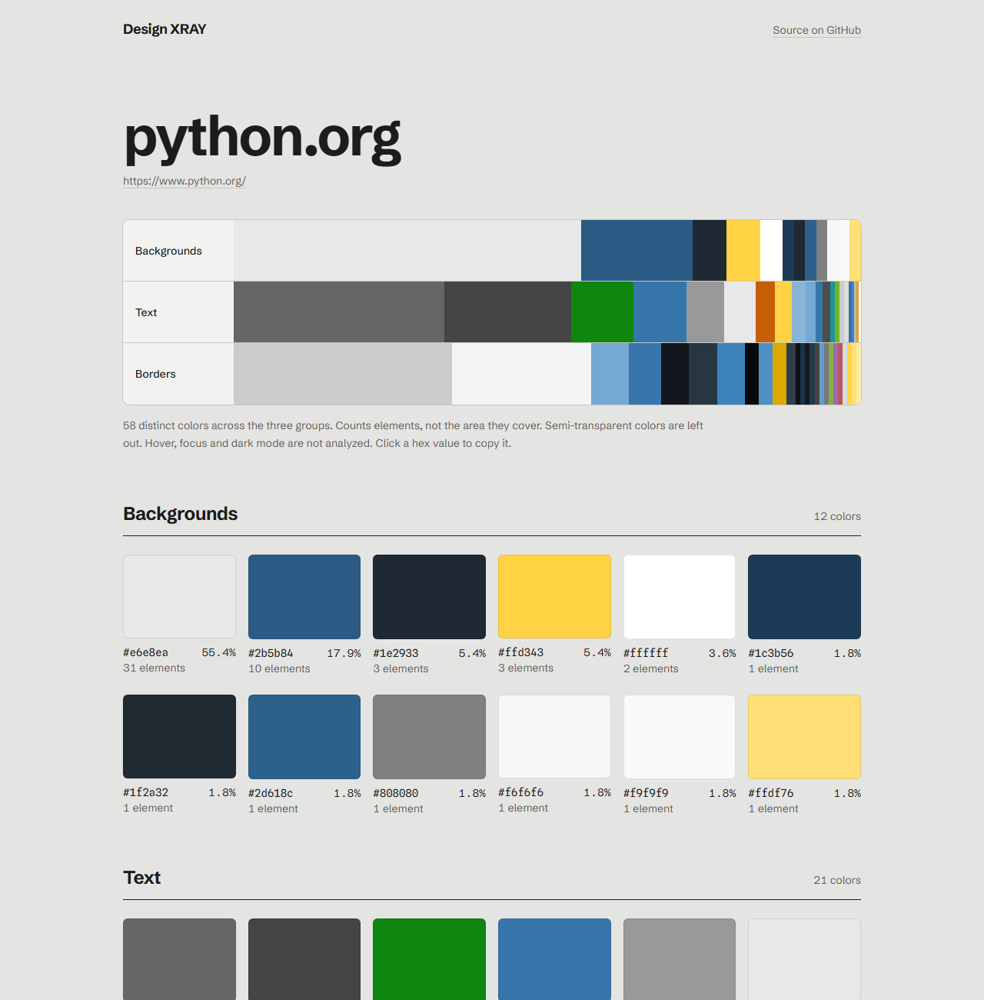

# Design XRAY

Paste the address of a public web page and see the colors it is actually made of: every background, text and border color used by its visible elements, counted and ranked.

**Live demo:** _coming soon_



## Why

Tools that inspect CSS tend to list every value a stylesheet declares, including rules that never apply. Design XRAY opens the page in a real browser and reads what the browser actually renders, element by element. It is the first step of a larger idea: rebuilding a site's design system (colors, type, spacing, radius, shadows) as design tokens, starting from the live page. The full plan is in [docs/brief.md](docs/brief.md) (Italian).

## How it works

```
URL field (React) ──▶ POST /api/analyze (Express) ──▶ engine (Playwright + Chromium) ──▶ JSON ──▶ palettes on screen
```

1. **Client** (`client/`, React + Vite + Tailwind): sends the URL and shows the loading, error and result states.
2. **Server** (`server/`, Express): validates the URL, refuses internal addresses, limits each IP to 10 analyses every 10 minutes and runs at most 2 analyses at once (each one launches its own browser). It also serves the built client.
3. **Engine** (`engine/`, TypeScript run directly by Node): `analyzeUrl(url)` opens the page in headless Chromium, reads `getComputedStyle` for every visible element and counts colors:
   - **backgrounds:** elements with a solid `background-color`;
   - **text:** only elements that contain text themselves, so inherited colors are not counted again on every container;
   - **borders:** only the sides that are actually drawn (width > 0). An element counts once per distinct color.

   Colors are normalized to hex, so `rgb(255, 0, 0)` and `rgba(255, 0, 0, 1)` count as one color.

The engine knows nothing about the UI: the CLI (`node engine/src/cli.ts <url>`), the API and the tests all call the same function.

### SSRF protection

The server opens URLs chosen by strangers, from inside its own network. Two layers stop it from reaching internal services (`localhost`, private networks, the cloud metadata endpoint `169.254.169.254`):

1. **Before launching the browser,** the server resolves the domain and refuses internal addresses.
2. **Inside the browser,** every request Chromium makes (redirects, images, scripts, fetch, WebSockets) goes through a small proxy started for each analysis ([`engine/src/network/guardProxy.ts`](engine/src/network/guardProxy.ts)). The proxy resolves the host, checks every address and connects to the exact address it checked. Chromium never resolves names itself, so a public page that redirects to an internal address is refused, and so is a DNS answer that changes between the check and the connection (DNS rebinding).

Playwright's `page.route()` alone is not enough: for a redirect chain it only sees the first URL.

## Known limits

- **Counts elements, not area:** a color used on one huge hero counts the same as one used on a tiny badge.
- **Semi-transparent colors are left out:** they would have to be blended over the real background behind them first.
- Colors in formats other than `rgb()` (for example `oklab()`, `color()`) are left out too.
- Only the current state of the page: no `:hover`, `:focus` or dark mode. Pseudo-elements (`::before`, `::after`), `outline`, `box-shadow`, gradients and images are not read.
- One page per request, public pages only. Sites that block automated browsers return an error.
- Cookie banners and popups are analyzed like the rest of the page.

## Run it locally

Requires **Node 22.18 or later** (it runs the `.ts` files directly, without a build step).

```sh
# Engine and the Chromium build Playwright needs
cd engine
npm install
npx playwright install chromium
npm test                 # node:test, no internet needed
node src/cli.ts https://python.org

# API, on http://localhost:3000
cd ../server
npm install
npm run dev

# Client, on http://localhost:5173 (proxies /api to the server)
cd ../client
npm install
npm run dev
```

To run everything as in production (Express serving the built client on one port), run `npm run build` in `client/`, then `npm start` in `server/`. Or use Docker:

```sh
docker build -t design-xray .
docker run --rm -p 3000:3000 design-xray
```

Environment variables for the server: `PORT` (default 3000), `TRUST_PROXY` (number of proxy hops in front of the app, set to 1 in the Dockerfile), `RATE_LIMIT_MAX` (analyses per IP every 10 minutes, default 10).

## What's next

One property at a time, each one finished only when it shows up in the report:

1. Typography: font families and sizes.
2. `border-radius`.
3. Spacing: margin, padding, gap, and the base unit behind them.
4. Grouping similar colors by perceived distance (OKLCH, Delta E) and assigning roles (background, text, accent).

## Stack

TypeScript, Node.js, Playwright (as a library), Express 5, React, Vite, Tailwind CSS v4.
